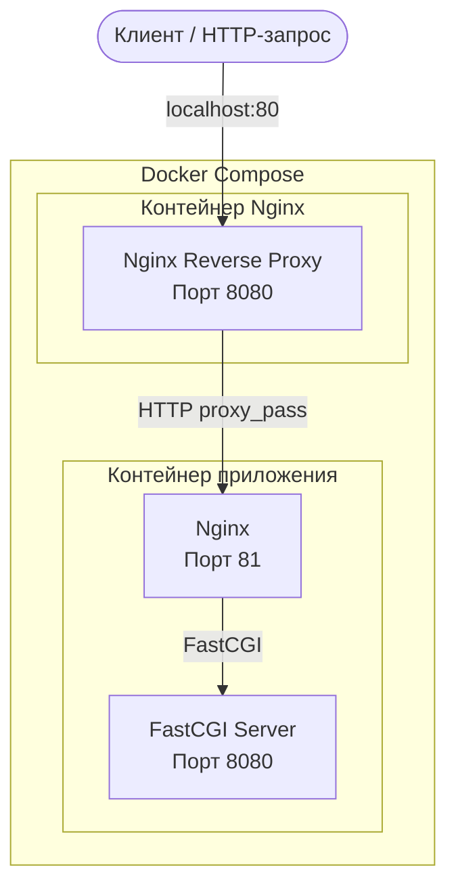

# DO5_Docker — Контейнеризация приложений с помощью Docker

<p align="center">
  
  
  
  
  
</p>

## О проекте

**DO5_Docker** — практический проект, посвящённый основам контейнеризации приложений с помощью Docker, управлению жизненным циклом контейнеров, созданию собственных Docker-образов и развёртыванию многоконтейнерных приложений.

Основная задача проекта — пройти полный цикл контейнеризации веб-приложения: разработать собственный FastCGI-сервер на языке C, упаковать его вместе с Nginx в Docker-образ, оптимизировать образ, проверить его безопасность и организовать развёртывание с помощью Docker Compose.

Проект демонстрирует практические навыки работы с Docker: от использования готовых образов до создания и запуска собственного многоконтейнерного приложения.

## Документация проекта

В репозитории также доступны полное условие учебного задания и подробный отчёт о выполненной работе.

- **[Полное задание School 21 — README_RUS.md](https://github.com/Shanteve/DO5_Docker/blob/develop/README_RUS.md)** — оригинальные требования и описание всех частей проекта.
- **[Отчёт о выполненных заданиях — report.md](https://github.com/Shanteve/DO5_Docker/blob/develop/src/report.md)** — подробное описание реализации всех заданий со скриншотами и подтверждением результатов.

### Основные возможности

- Работа с Docker-образами и управление жизненным циклом контейнеров.
- Исследование файловой системы контейнеров с помощью `docker exec`, `docker cp`, `docker export` и `docker import`.
- Разработка собственного FastCGI-сервера на языке C.
- Создание Docker-образов с использованием многоэтапной сборки (Multi-stage Build).
- Настройка Nginx для работы в качестве веб-сервера и обратного прокси.
- Проверка безопасности Docker-образов с помощью Dockle.
- Запуск приложения от непривилегированного пользователя.
- Развёртывание нескольких контейнеров с помощью Docker Compose.
- Организация взаимодействия между контейнерами через Docker Network.

## Архитектура проекта

Итоговое приложение состоит из двух контейнеров:

1. **Контейнер приложения** — содержит собственный FastCGI-сервер на C и Nginx.
2. **Контейнер обратного прокси** — содержит отдельный экземпляр Nginx, который принимает внешние HTTP-запросы и перенаправляет их в контейнер приложения.

### Схема взаимодействия компонентов



### Обработка HTTP-запроса

1. Клиент отправляет HTTP-запрос на `localhost:80`.
2. Внешний контейнер Nginx принимает запрос на порту `8080`.
3. Nginx перенаправляет запрос во внутренний Nginx контейнера приложения на порт `81`.
4. Внутренний Nginx передаёт запрос FastCGI-серверу на порт `8080`.
5. FastCGI-сервер обрабатывает запрос и возвращает HTTP-ответ с содержимым `Hello World!`.

## Технологический стек

| Технология | Назначение |
|---|---|
| Docker Engine | Контейнеризация приложений и управление образами |
| Docker Compose | Развёртывание многоконтейнерных приложений |
| Alpine Linux | Лёгкая базовая операционная система |
| Nginx | Веб-сервер и обратный прокси |
| FastCGI | Взаимодействие Nginx с приложением |
| C | Разработка собственного FastCGI-сервера |
| GCC | Компиляция приложения |
| spawn-fcgi | Запуск FastCGI-процесса |
| Dockle | Анализ безопасности Docker-образов |

## Выполненные задачи

### 1. Работа с Docker-образами и контейнерами

Начал работу с официального образа Nginx и изучил основные операции управления контейнерами.

Реализовано:

- Загрузка официального Docker-образа Nginx с помощью `docker pull`.
- Просмотр доступных образов через `docker images`.
- Создание и управление контейнерами с помощью `docker run`, `docker stop`, `docker restart`.
- Анализ конфигурации контейнеров через `docker inspect`.
- Изучение IP-адресов контейнеров, проброшенных портов и размеров файловых систем.
- Публикация портов контейнеров на хостовой машине.

### 2. Работа с файловой системой контейнеров

Изучил особенности файловой системы контейнеров и механизмов создания Docker-образов.

Реализовано:

- Получение конфигурации Nginx из работающего контейнера с помощью `docker exec`.
- Изменение конфигурации Nginx для включения endpoint статистики сервера.
- Копирование файлов конфигурации в контейнер через `docker cp`.
- Перезагрузка конфигурации Nginx без пересоздания контейнера.
- Экспорт файловой системы контейнера с помощью `docker export`.
- Удаление исходного контейнера и Docker-образа.
- Создание нового Docker-образа из экспортированного архива через `docker import`.
- Проверка сохранности изменённой конфигурации Nginx в импортированном образе.

### 3. Разработка FastCGI-сервера на языке C

Разработал минимальный веб-сервер с использованием языка C и протокола FastCGI.

Приложение обрабатывает входящие FastCGI-запросы и возвращает HTML-ответ.

Основная логика приложения:

```c
#include "fcgi_stdio.h"
#include <stdlib.h>

int main(void) {
    while (FCGI_Accept() >= 0) {
        printf("Content-type: text/html\r\n"
               "Status: 200 OK\r\n\r\n"
               "Hello World!");
    }

    return 0;
}
```

Реализовано:

- Цикл обработки входящих запросов с использованием `FCGI_Accept()`.
- Формирование HTTP-заголовков и HTML-ответа.
- Компиляция приложения с помощью GCC.
- Запуск FastCGI-сервера через `spawn-fcgi` на порту `8080`.
- Настройка Nginx для передачи запросов FastCGI-приложению.
- Проверка работоспособности приложения через браузер.

### 4. Создание собственного Docker-образа

Создал собственный Docker-образ, содержащий FastCGI-приложение и Nginx.

Для сборки использовал Multi-stage Build.

**Этап сборки (Build Stage):**

- Использовал Alpine Linux в качестве лёгкой среды сборки.
- Установил GCC, библиотеки musl и заголовочные файлы FastCGI.
- Выполнил компиляцию приложения на C.

**Этап запуска (Runtime Stage):**

- Использовал официальный образ Nginx на базе Alpine Linux.
- Установил необходимые runtime-зависимости FastCGI.
- Скопировал скомпилированное приложение из предыдущего этапа.
- Добавил собственную конфигурацию Nginx.
- Создал отдельного непривилегированного пользователя.
- Настроил запуск FastCGI через `spawn-fcgi` и Nginx.

Использование Multi-stage Build позволяет исключить инструменты компиляции и ненужные зависимости из итогового Docker-образа.

### 5. Проверка безопасности Docker-образа с помощью Dockle

Провёл анализ собственного Docker-образа с помощью Dockle.

В процессе проверки улучшил безопасность контейнера:

- Создал отдельного пользователя для запуска приложения вместо использования root.
- Настроил права доступа и владельцев директорий, необходимых для работы Nginx.
- Исключил build-зависимости из финального образа благодаря Multi-stage Build.
- Исправил замечания, выявленные Dockle.
- Повторно выполнил проверку после внесения изменений.

**Результат:** финальный Docker-образ прошёл проверки Dockle без обнаруженных ошибок и предупреждений, согласно отчёту по проекту.

### 6. Развёртывание приложения с помощью Docker Compose

Создал конфигурацию Docker Compose для развёртывания приложения, состоящего из двух независимых контейнеров.

**Контейнер приложения:**

- Собирает собственный Docker-образ на основе Dockerfile приложения.
- Запускает FastCGI-приложение и внутренний Nginx.
- Не публикует порт приложения непосредственно на хостовую машину.

**Контейнер обратного прокси:**

- Использует официальный Docker-образ Nginx.
- Подключает собственную конфигурацию Nginx через read-only volume.
- Перенаправляет входящие запросы в контейнер приложения.
- Публикует порт `80` хостовой машины на порт `8080` контейнера.

Дополнительно реализовано:

- Описание сервисов в `docker-compose.yml`.
- Организация взаимодействия контейнеров через Docker Compose Network.
- Использование DNS Docker Compose для обращения к сервисам по именам вместо статических IP-адресов.
- Подключение конфигурации Nginx через read-only bind mount.
- Настройка зависимостей между сервисами.
- Сборка и запуск приложения с помощью Docker Compose.

## Принятые технические решения

- **Multi-stage Build** — разделение этапов компиляции и запуска позволяет уменьшить размер итогового образа и исключить инструменты сборки из runtime-окружения.
- **Alpine Linux** — использование лёгких базовых образов позволяет сократить количество ненужных пакетов.
- **Non-root execution** — запуск приложения от непривилегированного пользователя снижает потенциальный ущерб при компрометации контейнера.
- **Разделение Nginx и FastCGI** — Nginx отвечает за обработку HTTP-запросов, а FastCGI-приложение — за выполнение логики обработки запросов.
- **Docker Compose Networking** — взаимодействие контейнеров через имена сервисов без необходимости задавать статические IP-адреса.
- **Read-only configuration mount** — подключение конфигурации Nginx с параметром `:ro` предотвращает её изменение изнутри контейнера обратного прокси.
- **Dockle** — автоматизированный анализ Docker-образов помогает обнаруживать проблемы безопасности и конфигурации.

## Структура проекта

```text
DO5_Docker/
├── README.md
├── README_RUS.md
└── src/
    ├── Dockerfile
    ├── Dockerfile_part_4
    ├── docker-compose.yml
    ├── nginx.conf
    │
    ├── nginx/
    │   └── nginx.conf
    │
    ├── nginx_part_6/
    │   └── nginx.conf
    │
    ├── server/
    │   └── server.c
    │
    ├── report.md
    └── report_images/
        ├── part_1/
        ├── part_2/
        ├── part_3/
        ├── part_4/
        ├── part_5/
        └── part_6/
```

## Результаты проекта

В результате был разработан и развёрнут собственный контейнеризированный веб-сервер.

В ходе проекта:

- Изучены принципы работы Docker-образов, слоёв и контейнеров.
- Получен практический опыт работы с Docker CLI и файловыми системами контейнеров.
- Разработан FastCGI-сервер на языке C.
- Создан собственный Docker-образ с использованием Multi-stage Build.
- Настроена связка Nginx и FastCGI.
- Реализован запуск приложения от непривилегированного пользователя.
- Проведён анализ безопасности Docker-образа с помощью Dockle.
- Организовано развёртывание многоконтейнерного приложения через Docker Compose.

## Полученные навыки
- Docker и Docker CLI
- Dockerfile и Multi-stage Build
- Управление жизненным циклом контейнеров
- Работа с файловыми системами контейнеров
- Docker Networking
- Docker Compose
- Nginx и Reverse Proxy
- FastCGI
- Основы разработки на C и компиляции GCC
- Безопасность контейнеров
- Dockle и анализ Docker-образов
- Linux: права доступа и управление пользователями