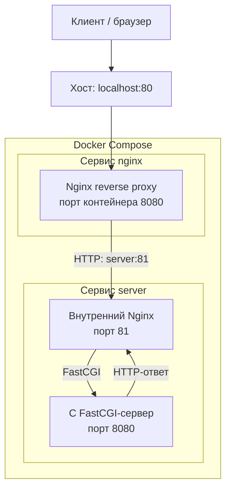

# DO5_Docker — создание и контейнеризация FastCGI веб-сервера

<p align="center">
  
  
  
  
  
</p>

> **Полезные материалы. Важно!**
>
> - [Полные задания School 21](README_RUS.md) — исходные требования и описание всех частей проекта.
> - [Подробный отчёт о выполнении](src/report.md) — ход работы, команды и скриншоты, подтверждающие результат.

## О проекте

**DO5_Docker** — практический проект в рамках обучения в School 21, посвящённый основам Docker и созданию собственного Docker-образа для веб-сервера.

В ходе проекта я прошёл путь от запуска готового образа Nginx до создания собственного приложения из FastCGI-сервера на C и Nginx, его упаковки в Docker-образ и развёртывания нескольких контейнеров с помощью Docker Compose.

Итоговая конфигурация включает FastCGI-сервер на C, внутренний Nginx, который взаимодействует с ним по протоколу FastCGI, и отдельный внешний Nginx в роли reverse proxy. Для сборки приложения используется multi-stage Dockerfile. В контейнере приложения настроен непривилегированный пользователь, а готовый образ проверяется с помощью Dockle.

> Это учебный проект, направленный на освоение Docker и принципов контейнеризации. Он не позиционируется как готовая production-платформа.

## Кратко о технологиях

| Область | Реализация |
|---|---|
| Приложение | Минимальный FastCGI-сервер на C |
| Веб-сервер | Nginx |
| Запуск FastCGI-процесса | `spawn-fcgi` |
| Базовые образы для контейнеров | Alpine Linux и Nginx Alpine |
| Сборка образа | Dockerfile с несколькими этапами (multi-stage build) |
| Проверка образа на уязвимости | Dockle |
| Запуск нескольких контейнеров | Docker Compose |

## Архитектура

Финальная конфигурация Docker Compose состоит из двух сервисов.

- **`server`** собирается из собственного Dockerfile. Внутри него запускаются C FastCGI-сервер на порту `8080` и Nginx, принимающий HTTP-запросы на порту `81`.
- **`nginx`** использует официальный образ Nginx и выполняет роль внешнего reverse proxy. Он принимает соединения на порту контейнера `8080`, перенаправляет запросы на `server:81` и публикует порт `80` на хост.



### Как проходит запрос

1. Клиент отправляет HTTP-запрос на `http://localhost:80`.
2. Docker перенаправляет опубликованный порт `80` хоста на порт `8080` сервиса `nginx`.
3. Внешний Nginx передаёт запрос внутреннему Nginx по адресу `server:81`. Здесь используется DNS-имя сервиса Docker Compose, а не IP-адрес контейнера.
4. Внутренний Nginx передаёт запрос FastCGI-процессу по адресу `127.0.0.1:8080`.
5. C-приложение возвращает `Hello World!`. Ответ проходит обратно через оба экземпляра Nginx к клиенту.

В конфигурации внешнего Nginx также предусмотрен location `/status`, использующий модуль `stub_status`.

## Что было реализовано

### 1. Изучение жизненного цикла контейнеров

Работу с Docker я начал с готового образа Nginx. Это позволило разобраться с основными сущностями и командами до создания собственного образа.

В рамках этой части я:

- загрузил образ и изучил список локальных образов с помощью `docker pull` и `docker images`;
- создавал, запускал, останавливала и перезапускал контейнеры;
- изучал конфигурацию и состояние контейнера с помощью `docker inspect`;
- проверял IP-адреса, опубликованные порты и информацию о файловой системе;
- публиковал порты контейнера на хосте и проверял доступность Nginx через браузер.

**Полученный опыт:** понимание разницы между образом и контейнером, жизненного цикла контейнера, публикации портов и базовой диагностики через Docker CLI.

### 2. Изменение и экспорт файловой системы контейнера

Далее я изучил, как изменять файлы внутри контейнера, копировать их между хостом и контейнером, а также экспортировать и импортировать файловую систему.

Я получил конфигурацию Nginx, изменил её для включения endpoint `stub_status`, скопировал конфигурацию в работающий контейнер и перезагрузил Nginx. После этого экспортировал файловую систему контейнера, удалил исходные контейнер и образ, импортировал архив в виде нового образа и проверил, что страница со статусом Nginx доступна.

Использованные команды и механизмы:

- `docker exec` — выполнение команд внутри работающего контейнера;
- `docker cp` — копирование файлов между хостом и контейнером;
- `docker export` — экспорт файловой системы контейнера в архив;
- `docker import` — создание образа из экспортированной файловой системы;
- перезагрузка конфигурации Nginx.

Это упражнение помогло разобраться в устройстве файловой системы контейнера. При этом `docker export` и `docker import` не заменяют сборку воспроизводимого образа через Dockerfile: они не сохраняют историю сборки и метаданные образа в том же виде.

### 3. Разработка FastCGI-приложения на C

Я написал минимальный FastCGI-сервер на языке C. Он принимает FastCGI-запросы в цикле и возвращает HTTP-ответ с телом `Hello World!`.

```c
#include "fcgi_stdio.h"
#include <stdlib.h>

int main(void) {
    while (FCGI_Accept() >= 0) {
        printf("Content-type: text/html\r\n"
               "Status: 200 OK\r\n\r\n"
               "Hello World!");
    }

    return 0;
}
```

Приложение компилируется с помощью GCC и запускается через `spawn-fcgi`. Nginx настроен на передачу запросов FastCGI-процессу с помощью директивы `fastcgi_pass`.

Так разделяются обязанности компонентов: C-процесс формирует ответ приложения, а Nginx обрабатывает HTTP-соединения и взаимодействует с FastCGI-сервером.

### 4. Создание собственного образа с помощью multi-stage build

Для упаковки FastCGI-приложения и Nginx я использовал Dockerfile с двумя этапами сборки.

**Этап сборки (builder)**

- Используется Alpine Linux.
- Устанавливаются GCC, `musl-dev` и `fcgi-dev`.
- Исходный файл `server.c` компилируется с подключением библиотеки FastCGI.

**Этап запуска (runtime)**

- В качестве основы используется Nginx Alpine.
- Устанавливаются runtime-пакеты `spawn-fcgi` и `fcgi`.
- Из этапа сборки копируется только скомпилированный бинарный файл сервера.
- Добавляется конфигурация Nginx.
- Создаются пользователь и группа приложения, настраиваются права доступа к необходимым каталогам и файлам.
- Запускаются FastCGI-сервер и Nginx.

Главная идея multi-stage build — инструменты компиляции и заголовочные файлы остаются на этапе сборки. В финальный образ попадает только готовый бинарный файл приложения, а не весь набор build-зависимостей.

### 5. Проверка Docker-образа с помощью Dockle

Для проверки собственного образа на соответствие рекомендациям по безопасности и конфигурации контейнеров я использовал Dockle.

Работа проходила итеративно:

1. Запустил Dockle для первоначального образа.
2. Изучил найденные замечания.
3. Внёс изменения в Dockerfile, в том числе настроил непривилегированного пользователя и права на runtime-каталоги Nginx.
4. Пересобрал образ и повторно запустил Dockle.

В отчёте проекта сохранены скриншоты первоначальной и итоговой проверок. Согласно отчёту, итоговый запуск Dockle завершился без предупреждений и ошибок.

Важно учитывать, что Dockle проверяет отдельные настройки и практики сборки образа. Он не заменяет сканирование уязвимостей, управление зависимостями и тестирование безопасности во время выполнения.

### 6. Запуск приложения с помощью Docker Compose

На заключительном этапе я перешёл от одного собственного образа к развёртыванию приложения из двух сервисов.

Файл `docker-compose.yml` описывает:

- `server` — сборку собственного образа из текущего каталога;
- `nginx` — запуск внешнего Nginx reverse proxy, подключение его конфигурации в режиме только для чтения и публикацию порта `80` хоста на порт `8080` контейнера.

Docker Compose автоматически создаёт сеть проекта. Внешний Nginx обращается к приложению по DNS-имени сервиса `server`, а не по динамическому IP-адресу контейнера.

Конфигурация reverse proxy подключается с параметром `:ro`. Это позволяет контейнеру читать конфигурационный файл с хоста, но не изменять его через точку монтирования.

## Ключевые технические решения

| Решение | Зачем оно используется |
|---|---|
| Multi-stage build | Исключить компилятор и build-зависимости из финального runtime-образа. |
| Alpine Linux | Использовать компактный базовый образ для небольшого приложения. |
| Nginx + FastCGI | Разделить обработку HTTP-запросов и логику приложения. |
| Отдельный reverse proxy | Создать единую внешнюю точку входа и направлять запросы к приложению по внутренней сети Compose. |
| DNS Docker Compose | Обращаться к сервису по имени `server`, не привязываясь к динамическому IP контейнера. |
| Непривилегированный пользователь | Снизить уровень привилегий процесса приложения внутри контейнера. |
| Read-only mount конфигурации | Запретить изменение подключённого файла конфигурации из контейнера reverse proxy. |
| Проверка Dockle | Выявлять часть проблем конфигурации и сборки образа на этапе разработки. |

## Запуск проекта

### Требования

- Docker Engine;
- Docker Compose plugin (`docker compose`);
- Git.

Клонируйте репозиторий и перейдите в каталог с Dockerfile и Compose-файлом:

```bash
git clone https://github.com/Shanteve/DO5_Docker.git
cd DO5_Docker/src
```

Соберите образы:

```bash
docker compose build
```

Запустите сервисы:

```bash
docker compose up -d
```

Проверьте состояние контейнеров и логи:

```bash
docker compose ps
docker compose logs
```

Проверьте ответ приложения:

```bash
curl http://localhost/
```

Ожидаемый ответ:

```text
Hello World!
```

Проверьте endpoint со статусом Nginx:

```bash
curl http://localhost/status
```

Остановите сервисы и удалите созданные Compose контейнеры и сеть:

```bash
docker compose down
```

## Структура репозитория

```text
DO5_Docker/
├── README.md
├── README_RUS.md
└── src/
    ├── Dockerfile                 # Итоговый multi-stage Dockerfile
    ├── Dockerfile_part_4          # Dockerfile из предыдущей части задания
    ├── docker-compose.yml         # Развёртывание двух сервисов
    ├── nginx/
    │   └── nginx.conf             # Nginx внутри контейнера приложения
    ├── nginx_part_6/
    │   └── nginx.conf             # Конфигурация внешнего reverse proxy
    ├── server/
    │   └── server.c               # FastCGI-приложение на C
    ├── report.md                  # Подробный отчёт о выполнении
    └── report_images/             # Скриншоты по частям проекта
```

## Проверка результата

В подробном отчёте приведены скриншоты, демонстрирующие:

- загрузку образа Nginx, жизненный цикл контейнера, инспектирование и публикацию портов;
- изменение конфигурации, копирование файлов, экспорт и импорт контейнера, работу страницы статуса Nginx;
- ответ FastCGI-сервера;
- сборку собственного Docker-образа и ответ приложения;
- первоначальную и итоговую проверки Dockle;
- сборку и запуск Docker Compose, а также итоговую проверку приложения через браузер.

Подробности и подтверждения выполнения находятся в [отчёте](src/report.md).

## Что я изучил

- Разницу между Docker-образами и контейнерами, способы просмотра их конфигурации и состояния.
- Изменение файловой системы контейнера, экспорт и импорт, а также преимущества воспроизводимой сборки через Dockerfile.
- Сборку и запуск небольшого FastCGI-приложения.
- Взаимодействие Nginx с FastCGI backend.
- Принцип multi-stage build и разделение build-time и runtime-зависимостей.
- Запуск процесса от непривилегированного пользователя и проверку образа с помощью Dockle.
- Сетевое взаимодействие контейнеров Docker Compose и DNS по именам сервисов.

## Границы проекта и дальнейшее развитие

Этот проект намеренно сосредоточен на основах Docker. Если рассматривать дальнейшее развитие данного проекта, я бы рассмотрел следующие улучшения для приближения к production-подходу:

- Добавить health check и учитывать готовность приложения при запуске зависимых сервисов. Сам по себе `depends_on` в Compose не гарантирует, что приложение уже готово принимать запросы.
- Фиксировать базовые образы по digest и добавить автоматическое сканирование образов на уязвимости в CI.
- Использовать read-only root filesystem там, где это возможно, удалять ненужные Linux capabilities и задавать ограничения ресурсов.
- Добавить структурированные логи приложения и Nginx, метрики и оповещения.
- Добавить автоматические тесты и CI pipeline для сборки, проверки и тестирования образов.

## Ссылки

- [Репозиторий DO5_Docker на GitHub](https://github.com/Shanteve/DO5_Docker)
- [Полное задание School 21](README_RUS.md)
- [Подробный отчёт с командами и скриншотами](src/report.md)