## Part 1
- 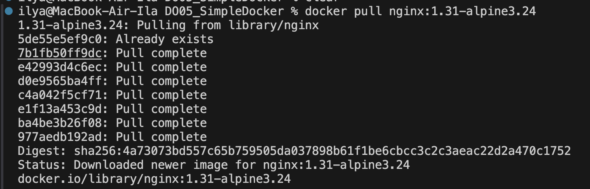
Скачал nginx образ. Использован легковесный дистрибутив alpine + полный тег

- 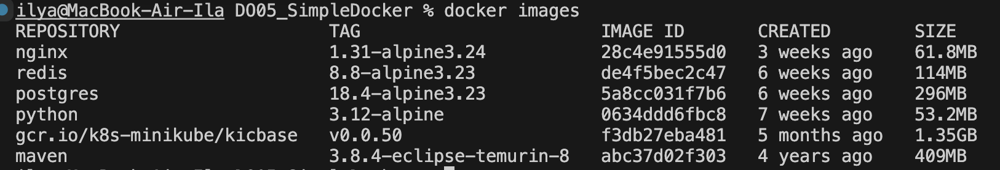
Вывод docker images
- 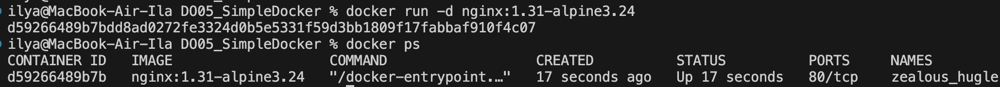
Запуск контейнера и вывод всех запущенных
- Просмотр информации о контейнере  
ilya@MacBook-Air-Ila DO05_SimpleDocker % docker inspect --size d592
```
[
    {
        "Id": "d59266489b7bdd8ad0272fe3324d0b5e5331f59d3bb1809f17fabbaf910f4c07",
        "Created": "2026-08-07T09:12:36.33276155Z",
        "Path": "/docker-entrypoint.sh",
        "Args": [
            "nginx",
            "-g",
            "daemon off;"
        ],
        "State": {
            "Status": "running",
            "Running": true,
            "Paused": false,
            "Restarting": false,
            "OOMKilled": false,
            "Dead": false,
            "Pid": 1803,
            "ExitCode": 0,
            "Error": "",
            "StartedAt": "2026-08-07T09:24:59.188214505Z",
            "FinishedAt": "2026-08-07T09:18:50.062363126Z"
        },
        "Image": "sha256:28c4e91555d001bb0f6b2796e565bfa75302711a0d6e67c5562eb2f7d54d2483",
        "ResolvConfPath": "/var/lib/docker/containers/d59266489b7bdd8ad0272fe3324d0b5e5331f59d3bb1809f17fabbaf910f4c07/resolv.conf",
        "HostnamePath": "/var/lib/docker/containers/d59266489b7bdd8ad0272fe3324d0b5e5331f59d3bb1809f17fabbaf910f4c07/hostname",
        "HostsPath": "/var/lib/docker/containers/d59266489b7bdd8ad0272fe3324d0b5e5331f59d3bb1809f17fabbaf910f4c07/hosts",
        "LogPath": "/var/lib/docker/containers/d59266489b7bdd8ad0272fe3324d0b5e5331f59d3bb1809f17fabbaf910f4c07/d59266489b7bdd8ad0272fe3324d0b5e5331f59d3bb1809f17fabbaf910f4c07-json.log",
        "Name": "/zealous_hugle",
        "RestartCount": 0,
        "Driver": "overlay2",
        "Platform": "linux",
        "MountLabel": "",
        "ProcessLabel": "",
        "AppArmorProfile": "",
        "ExecIDs": null,
        "HostConfig": {
            "Binds": null,
            "ContainerIDFile": "",
            "LogConfig": {
                "Type": "json-file",
                "Config": {}
            },
            "NetworkMode": "default",
            "PortBindings": {},
            "RestartPolicy": {
                "Name": "no",
                "MaximumRetryCount": 0
            },
            "AutoRemove": false,
            "VolumeDriver": "",
            "VolumesFrom": null,
            "ConsoleSize": [
                11,
                138
            ],
            "CapAdd": null,
            "CapDrop": null,
            "CgroupnsMode": "private",
            "Dns": [],
            "DnsOptions": [],
            "DnsSearch": [],
            "ExtraHosts": null,
            "GroupAdd": null,
            "IpcMode": "private",
            "Cgroup": "",
            "Links": null,
            "OomScoreAdj": 0,
            "PidMode": "",
            "Privileged": false,
            "PublishAllPorts": false,
            "ReadonlyRootfs": false,
            "SecurityOpt": null,
            "UTSMode": "",
            "UsernsMode": "",
            "ShmSize": 67108864,
            "Runtime": "runc",
            "Isolation": "",
            "CpuShares": 0,
            "Memory": 0,
            "NanoCpus": 0,
            "CgroupParent": "",
            "BlkioWeight": 0,
            "BlkioWeightDevice": [],
            "BlkioDeviceReadBps": [],
            "BlkioDeviceWriteBps": [],
            "BlkioDeviceReadIOps": [],
            "BlkioDeviceWriteIOps": [],
            "CpuPeriod": 0,
            "CpuQuota": 0,
            "CpuRealtimePeriod": 0,
            "CpuRealtimeRuntime": 0,
            "CpusetCpus": "",
            "CpusetMems": "",
            "Devices": [],
            "DeviceCgroupRules": null,
            "DeviceRequests": null,
            "MemoryReservation": 0,
            "MemorySwap": 0,
            "MemorySwappiness": null,
            "OomKillDisable": null,
            "PidsLimit": null,
            "Ulimits": null,
            "CpuCount": 0,
            "CpuPercent": 0,
            "IOMaximumIOps": 0,
            "IOMaximumBandwidth": 0,
            "MaskedPaths": [
                "/proc/asound",
                "/proc/acpi",
                "/proc/kcore",
                "/proc/keys",
                "/proc/latency_stats",
                "/proc/timer_list",
                "/proc/timer_stats",
                "/proc/sched_debug",
                "/proc/scsi",
                "/sys/firmware",
                "/sys/devices/virtual/powercap"
            ],
            "ReadonlyPaths": [
                "/proc/bus",
                "/proc/fs",
                "/proc/irq",
                "/proc/sys",
                "/proc/sysrq-trigger"
            ]
        },
        "GraphDriver": {
            "Data": {
                "LowerDir": "/var/lib/docker/overlay2/b8f0b2284c078d60b881b53ff9e511fcc2acabe34c7459b4a500fc1eb3cd957d-init/diff:/var/lib/docker/overlay2/31b5b8b47cc2576da3532ab92d4c2138eaf27dcc8e47f938bb6d1cb1ec9b01f4/diff:/var/lib/docker/overlay2/21627acf3b43e4aa74a171e9c7feb2ab2ae59e5de045a49353321cb621d7c9b3/diff:/var/lib/docker/overlay2/d1ab345c7311abe5033f78e3d4fa7a28c0b81ba9f1565017b7ea3455b162fec4/diff:/var/lib/docker/overlay2/be98b5d1ec99c0d7c1ecdf50bb33dfceda902de2b3723d350f7106fd31471bd9/diff:/var/lib/docker/overlay2/7050fd858717d5b9b877608eb366ca455c4242eb3a47acb143206178b94fa072/diff:/var/lib/docker/overlay2/c91532a196d111e6f73cee0777ca21809beb030af90449ea474761aa05f59a2b/diff:/var/lib/docker/overlay2/cd3b1071910b758113f423825e190a6521343aafd91a4378c822325d519f43c8/diff:/var/lib/docker/overlay2/e0e33d5c6ea0947d06b0d17927b01faf06dac4cd596828c314303b027bab4e68/diff",
                "MergedDir": "/var/lib/docker/overlay2/b8f0b2284c078d60b881b53ff9e511fcc2acabe34c7459b4a500fc1eb3cd957d/merged",
                "UpperDir": "/var/lib/docker/overlay2/b8f0b2284c078d60b881b53ff9e511fcc2acabe34c7459b4a500fc1eb3cd957d/diff",
                "WorkDir": "/var/lib/docker/overlay2/b8f0b2284c078d60b881b53ff9e511fcc2acabe34c7459b4a500fc1eb3cd957d/work"
            },
            "Name": "overlay2"
        },
        "SizeRw": 1095,
        "SizeRootFs": 61767084,
        "Mounts": [],
        "Config": {
            "Hostname": "d59266489b7b",
            "Domainname": "",
            "User": "",
            "AttachStdin": false,
            "AttachStdout": false,
            "AttachStderr": false,
            "ExposedPorts": {
                "80/tcp": {}
            },
            "Tty": false,
            "OpenStdin": false,
            "StdinOnce": false,
            "Env": [
                "PATH=/usr/local/sbin:/usr/local/bin:/usr/sbin:/usr/bin:/sbin:/bin",
                "NGINX_VERSION=1.31.3",
                "PKG_RELEASE=1",
                "DYNPKG_RELEASE=1",
                "NJS_VERSION=1.0.0",
                "NJS_RELEASE=1",
                "ACME_VERSION=0.4.1"
            ],
            "Cmd": [
                "nginx",
                "-g",
                "daemon off;"
            ],
            "Image": "nginx:1.31-alpine3.24",
            "Volumes": null,
            "WorkingDir": "/",
            "Entrypoint": [
                "/docker-entrypoint.sh"
            ],
            "OnBuild": null,
            "Labels": {
                "maintainer": "NGINX Docker Maintainers \u003cdocker-maint@nginx.com\u003e"
            },
            "StopSignal": "SIGQUIT"
        },
        "NetworkSettings": {
            "Bridge": "",
            "SandboxID": "28d7a34baa7c7f97eb0183e4a5928b8ed51088b6afa4ea967d80b87cb0e2edc0",
            "HairpinMode": false,
            "LinkLocalIPv6Address": "",
            "LinkLocalIPv6PrefixLen": 0,
            "Ports": {
                "80/tcp": null
            },
            "SandboxKey": "/var/run/docker/netns/28d7a34baa7c",
            "SecondaryIPAddresses": null,
            "SecondaryIPv6Addresses": null,
            "EndpointID": "f4171bf89021473fe2f251a5309225b3cb28f05c99c3615a0d3eed7673e47543",
            "Gateway": "172.17.0.1",
            "GlobalIPv6Address": "",
            "GlobalIPv6PrefixLen": 0,
            "IPAddress": "172.17.0.2",
            "IPPrefixLen": 16,
            "IPv6Gateway": "",
            "MacAddress": "02:42:ac:11:00:02",
            "Networks": {
                "bridge": {
                    "IPAMConfig": null,
                    "Links": null,
                    "Aliases": null,
                    "MacAddress": "02:42:ac:11:00:02",
                    "NetworkID": "64bf7553bab66fc6abb47b48337f2552d1b1bc0fdaf1e6556bea5675ecf1d105",
                    "EndpointID": "f4171bf89021473fe2f251a5309225b3cb28f05c99c3615a0d3eed7673e47543",
                    "Gateway": "172.17.0.1",
                    "IPAddress": "172.17.0.2",
                    "IPPrefixLen": 16,
                    "IPv6Gateway": "",
                    "GlobalIPv6Address": "",
                    "GlobalIPv6PrefixLen": 0,
                    "DriverOpts": null
                }
            }
        }
    }
]
```

По выводу команды можно определить:
1) Размер контейнера:
    1) SizeRF (размер самого контейнера без базового образа) - 1095 байт
    2) SizeRootFs (общий размер) - 61767084 байт
2) Список замапленных портов - их нет
3) Ip контейнера - 172.17.0.2


- 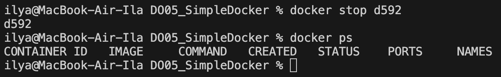
Остановка контейнера и вывод списка запущенных

- 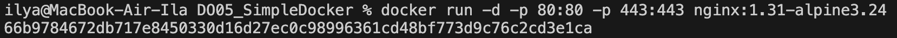
Запуск nginx с замапленными портами

- 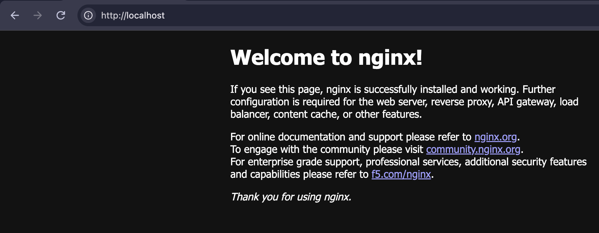
Стартовая страница nginx по адресу localhost:80

- 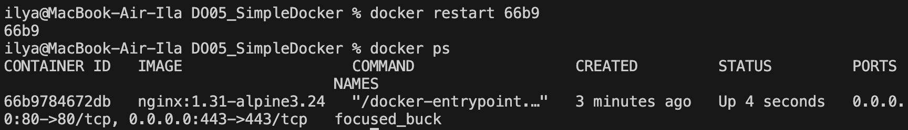
Перезапуск контейнера и вывод docker ps

## Part 2
- 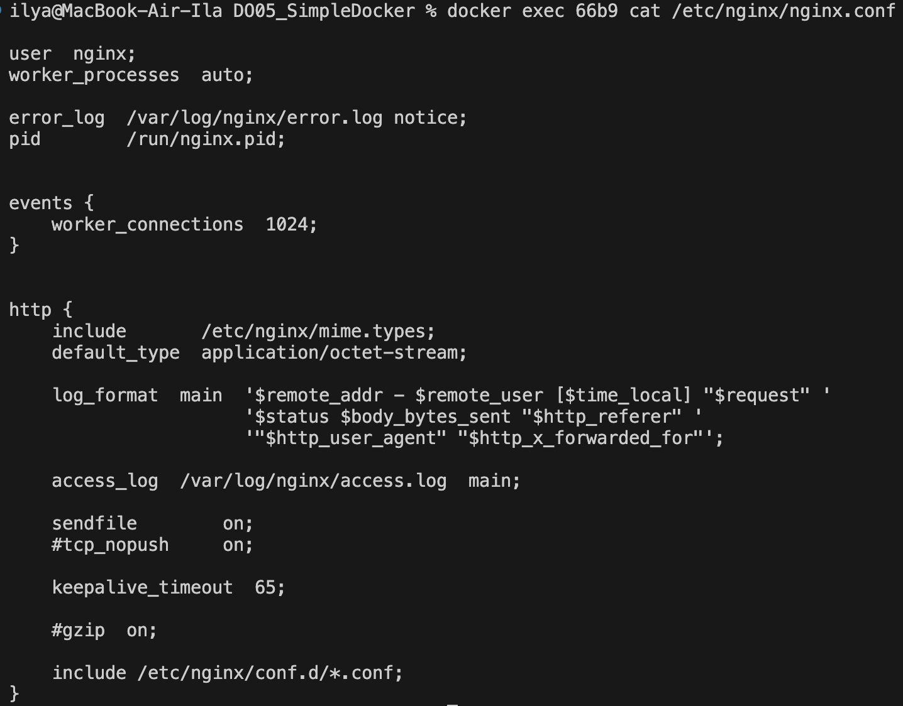
Вывод nginx.conf из контейнера

- Содержимое созданного nginx.conf 
```
user  nginx;
worker_processes  auto;

error_log  /var/log/nginx/error.log notice;
pid        /run/nginx.pid;

events {
    worker_connections  1024;
}

http {
    include       /etc/nginx/mime.types;
    default_type  application/octet-stream;

    log_format  main  '$remote_addr - $remote_user [$time_local] "$request" '
                      '$status $body_bytes_sent "$http_referer" '
                      '"$http_user_agent" "$http_x_forwarded_for"';

    access_log  /var/log/nginx/access.log  main;
    sendfile        on;
    keepalive_timeout  65;

    server {
        listen 80;

        location /status {
            stub_status;
        }
    }
}
```

- 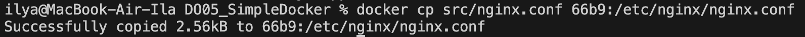
Копирование файла nginx.conf в контейнер

- 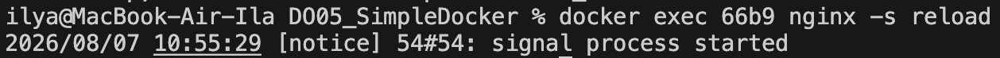
Перезагрузка nginx внутри контейнера

- 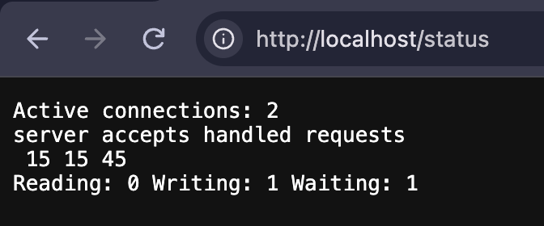
Status страница nginx в браузере

- 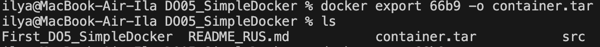
Экспортирование контейнера

- 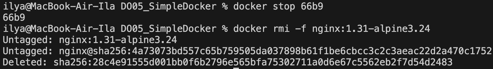
Остановка контейнера и удаление образа

- 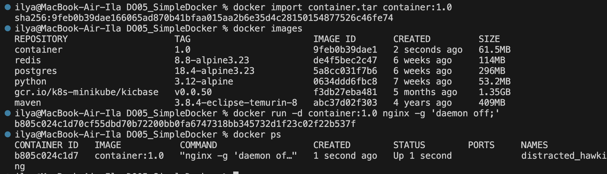
Импорт из файла и запуск контейнера

- 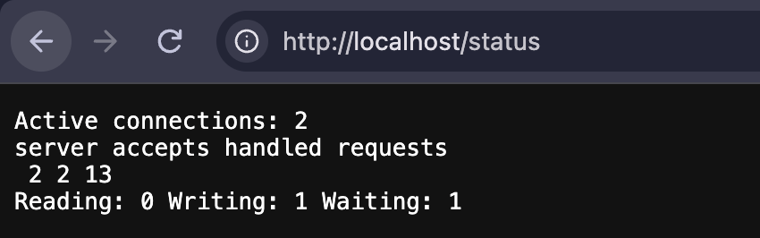
Статус страница nginx в браузере

## Part 3
- 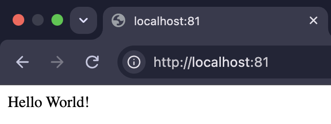
Вывод моего fastcgi сервера

## Part 4
- 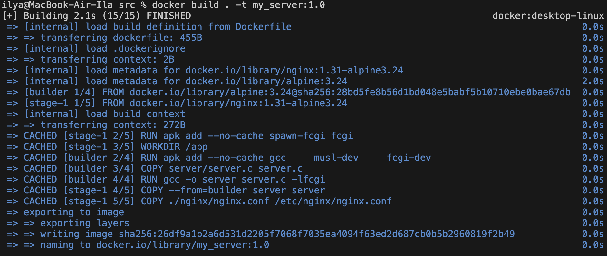
Сборка моего докер образа 

- 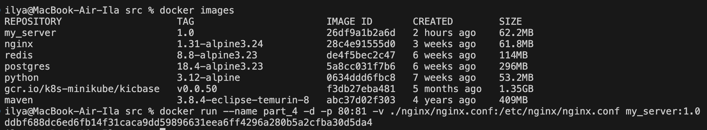
Вывод docker images и запуск полученного образа
- 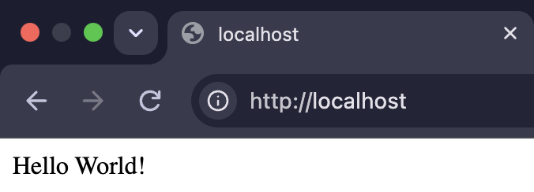

- 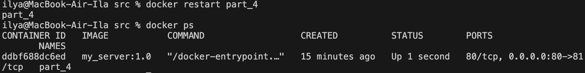
Перезапуск контейнера после обновления nginx конфига

- 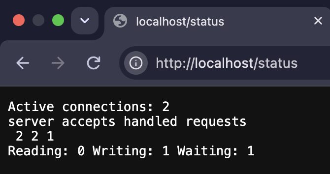
Status страница nginx в браузере

## Part 5
- 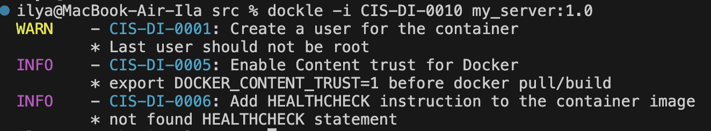
Первый запуск dockle
- 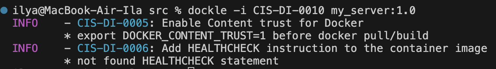
Вывод команды dockle после исправления Dockerfile

## Part 6
- 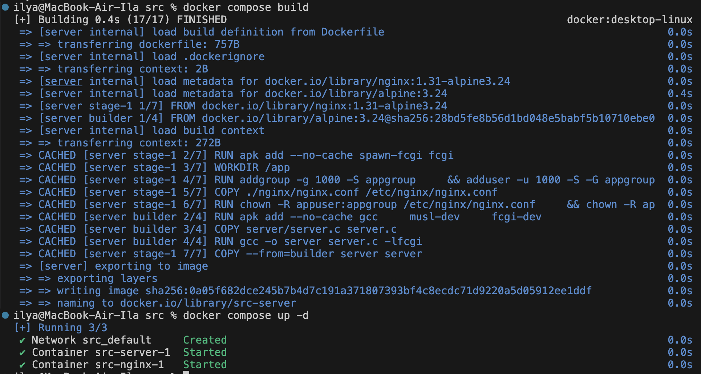
Сборка и запуск проекта
- 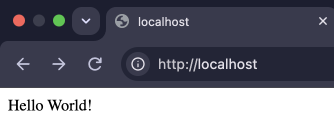
В результате всё работает